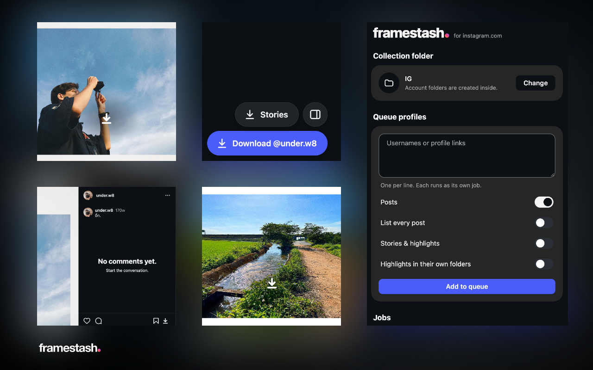

<p align="center">
  <picture>
    <source media="(prefers-color-scheme: dark)" srcset="design/wordmark-dark.png">
    
  </picture>
</p>

# Framestash



Save profiles, posts, stories and highlights from instagram.com into a local collection.

**[Install from the Chrome Web Store](https://chromewebstore.google.com/detail/framestash/nagekcpdhmahaaeigenbieglnknpkidp)**

Framestash is not affiliated with, endorsed by or sponsored by Instagram or Meta.

[MIT licence](LICENSE) · [Privacy policy](docs/privacy.md) · [Security policy](SECURITY.md) · [Releasing](docs/releasing.md)


**Status:** Framestash downloads profiles, single posts, grid and feed items, stories and highlights into an existing collection. All saving happens in a **Framestash side panel**, which holds the folder once for every tab and runs a **download queue**. The extension is in `extension/`; history and test results are in the git log. Specs are in `docs/`.

## Using Framestash

1. **Install.** Add it from the [Chrome Web Store](https://chromewebstore.google.com/detail/framestash/nagekcpdhmahaaeigenbieglnknpkidp), or, to run the source, go to `chrome://extensions`, turn on Developer mode, click **Load unpacked**, and choose the `extension/` folder. Pin Framestash to the toolbar.
2. **Choose the folder.** Click the Framestash icon to open the **side panel**. The first time, it shows a "Before you start" notice with the **Use responsibly** points below; click **I understand** to dismiss it (it won't come back, and nothing downloads until you do). Then **Choose** and pick the **root** folder of your collection: the one that contains the account folders, e.g. `IG`. It's remembered across tabs and restarts. After a browser restart, one click on **Allow access** restores it.
   - **Queue profiles:** paste usernames or profile URLs, one per line. Choose Posts and/or Stories & highlights, then **Add to queue**. A re-run of a profile that was fully listed before stops after 12 posts in a row you already have; turn on **List every post** to force a full pass. An interrupted profile run, full or not, continues from the page where it stopped. A queued profile with a saved position also shows **Start over**, which lists it from the newest post instead. Jobs run one after another, using any open, logged-in Instagram tab. The running job has a **Stop** button and queued jobs a **Remove** button; **Clear queue** removes every queued job and the finished rows, leaving the running one; files already saved are kept.
   - **Check collection:** a read-only report, shown in the panel. It lists duplicates, empty files, saved error pages, unrecognised names, and accounts split across folders.
   - **Closing the panel pauses the queue.** Queued and interrupted jobs come back when it reopens; any Framestash button in Instagram reopens it. A restarted profile job continues listing from the page where it stopped; files already saved are skipped.
3. **Download from Instagram.** Framestash adds buttons in the bottom-right corner, above Instagram's Messages button, plus a download icon in Instagram's own action rows:
   - **Profile:** **Download @user** saves every post. **Stories** saves the active stories plus every highlight.
   - **Post or reel page** (`/p/…`, `/reel/…`, `/reels/…`): **Save post** saves every slide into `<root>/<owner>/`.
   - **Feed posts, post pages and reels:** a download icon right after the save (bookmark) icon, in the post's action row or the reel's side column, also saves the whole post.
   - **Story page** (`/stories/<user>/`) or **highlight page** (`/stories/highlights/<id>/`): saves those stories. Stories go to `<root>/<user>/stories/`; with **Highlights in their own folders** on, each highlight goes to `stories/<highlight title or id>/`. The download icon in the story viewer's header, next to ⋯, saves only the item on screen. Downloading never marks a story as seen.
   - **Grid tiles** (profiles, Explore, any page with post thumbnails): on hover, a bold white download icon appears just below the centre on a soft dark glow, and saves the whole post without opening it.
   - **Panel icon** (corner): opens the side panel, or closes it if it is already open. The collection check is in the panel.

   Every button sends a job to the panel's queue, opening the panel first if it's closed, and the status card shows the job's progress.
4. **Re-run any time.** A job run again only fetches what's missing. A profile re-run stops listing after 12 already-saved posts in a row (pinned posts aside), once a previous run of it listed to the end; posts deleted from disk below that point come back only with **List every post**. An interrupted profile (Stop, closed panel, error) picks up its listing where it stopped instead of starting again from page 1. Failed items are listed in the panel's DevTools console.
5. **After updating Framestash**, reload open Instagram tabs. Chrome only adds the new scripts to pages loaded after the update, and Framestash tells you when this is needed.

## Use responsibly

- Framestash is for personal backup of content you have the right to keep.
- Respect creators' rights: don't republish other people's work without their permission.
- Bulk downloading can get your Instagram account rate-limited or blocked. Framestash paces its requests, but it can't prevent this.

## What it does

- **Data:** lists posts and stories with Instagram's own GraphQL queries, from the page world. Query IDs, tokens and query flags are read at runtime, never hardcoded ([instagram-api.md](docs/instagram-api.md)).
- **Naming:** `<root>/<username>/<username>_<taken_at>_<id>.<ext>`, the format existing collections already use ([collection-format.md](docs/collection-format.md)).
- **Duplicates:** media already present is skipped, matched on the media **pk** alone. A pk is unique across Instagram, so this survives renames and every name variant.
- **Account folders** are tied to their owner's **user ID** through a hidden `.framestash.json`, written the first time Framestash saves there.
  - A renamed account keeps its old folder. Folders are never renamed, and new usernames are recorded as aliases.
  - Old folders without the file are recognised from the `_<ownerId>` in their file names.
  - A folder is never shared by two accounts. If a username now belongs to someone else, that account gets `<username>_<userId>/`.
- **Writing:** never overwrites a non-empty file. A file is created only after a successful, status-checked download, so failures leave nothing behind. 0-byte, `.error.txt` and corrupt files already in a collection are reported by the check, never deleted.
- **Pacing:** each page of posts is written as it arrives. One pacer in the panel spaces every Instagram request 3–6 s apart, CDN downloads 0.3–1 s apart and rests up to 30–90 s after a job, in proportion to the requests it made, so a job of a request or two adds only a few seconds (all jittered), takes a 5–10 min break about every 150 requests, and keeps to a budget of 200 requests per hour and 1,500 per day that survives restarts. All of these are settings in the panel.
- **Circuit breaker:** a 429 or other HTTP error, a "please wait" / feedback_required reply, or a reply that isn't the expected data holds the whole queue for 30 min, doubling on each repeated trip (capped at 24 h). A login or checkpoint/challenge reply holds it until you click Resume.
- **Pause:** Pause queue halts the running job at its next request or download and starts nothing new until you click Resume. The pause survives closing the panel and restarting Chrome; a profile job then continues from its saved listing position.
- **Security:**
  - The folder handle is stored only in the panel's own extension storage, which pages on instagram.com can't reach.
  - Instagram tabs only list posts and stories. The panel validates every record and does all fetching and writing.
  - Replies from the page are untrusted: only Instagram-shaped usernames and IDs, and Instagram CDN URLs, are accepted.
  - Framestash buttons respond only to real user clicks (`isTrusted`), so page scripts can't trigger downloads.
- **Privacy:** no telemetry and no web-accessible resources. Permissions are `sidePanel`, plus host access to instagram.com and Instagram's CDN so the panel can fetch media.

**Not yet:** DASH video quality ([dash-video.md](docs/dash-video.md)).

**When Instagram changes something,** re-run playbook steps 1–5 ([playbook.md](docs/playbook.md)) and update [instagram-api.md](docs/instagram-api.md) before changing code.

## Working on tasks

Open work lives in `TASKS.md`. The saved workflow `fs-task` (`.claude/workflows/fs-task.js`) takes **one task per run**:

1. **Pick:** it needs a clean working tree. It takes the task you name (e.g. `T2`), or the first one with status `todo`.
2. **Plan:** a short design against `CLAUDE.md` and `docs/`.
3. **Build:** the change, plus tests.
4. **Review:** security, collection-compatibility and correctness reviews, with up to two reviewed fix rounds.
5. **Finish:** one commit. The task is set to `needs-check`, with the live checks only you can do (reloads, real clicks, folder picks).

Start it in Claude Code by asking it to run the `fs-task` workflow, optionally naming the task. To run several tasks back to back, use `fs-tasks` (`.claude/workflows/fs-tasks.js`) with a list of task ids; it stops at the first task that doesn't end in a commit, and the live checks collect in `TASKS.md` for later.

Plan, Build and Review run on the session's model, because they carry the security and compatibility rules. Pick and Finish are mechanical and run on smaller models.

## Look and feel

- **In-page buttons and status card:** they read Instagram's own theme variables, so they follow its light and dark modes. They match its floating Messages button: raised surface, hairline edge, shadow, pill shape and the `--hover-overlay` hover.
- **Action-row icon:** the post and reel download icon copies Instagram's action icons (24 px stroke, text colour, same hover). Grid-tile buttons keep Framestash's own round style.
- **Side panel:** modelled on Instagram's Settings pages (measured live), following the system light or dark setting.
- **Wordmark framestash.:** heavy sans-serif with a warm-to-violet gradient dot.
  - The toolbar icon is a near-black rounded square, so it isn't mistaken for Instagram's app icon.
  - Icons are stroke SVGs drawn for Framestash.
  - The logo sources are in `design/`; `render-icons.sh` rebuilds the PNGs, including the light and dark wordmarks at the top of this README. `wordmark.svg` is the brand master; the panel and the status card draw the wordmark in CSS.
  - The README cover is laid out by `design/hero/hero.html`: put screenshots you have the rights to in `design/hero/shots/` and run `design/hero/render.sh`.

## Checks

Run from the repo root:

```bash
node test/naming.test.js       # naming, dedup keys, routing, owner inference, file sniffing, queue entries
node test/collection.test.js   # folder resolution (renames, reused usernames, conflicts) and the collection check
node test/pacer.test.js        # pacing, budgets, block-signal classification and cool-downs
```

## Layout

```text
framestash/
├── extension/      the MV3 extension (load unpacked)
├── design/         logo sources + render-icons.sh; hero/ holds the README cover
├── test/           node checks (naming, collection, pacer)
├── scripts/        package.sh: runs the checks, then zips extension/ into dist/; check-manifest.js validates the manifest
├── docs/           collection format, Instagram API, probes, design notes, privacy policy
├── .github/        CI, release, CodeQL, Dependabot, store publish (docs/releasing.md)
├── TASKS.md        open work, consumed by the fs-task workflow
├── .claude/workflows/   fs-task.js (one task), fs-tasks.js (several in order)
├── README.md       this file
├── LICENSE         MIT licence
├── SECURITY.md     how to report a vulnerability
└── CLAUDE.md       ground rules for working here
```
